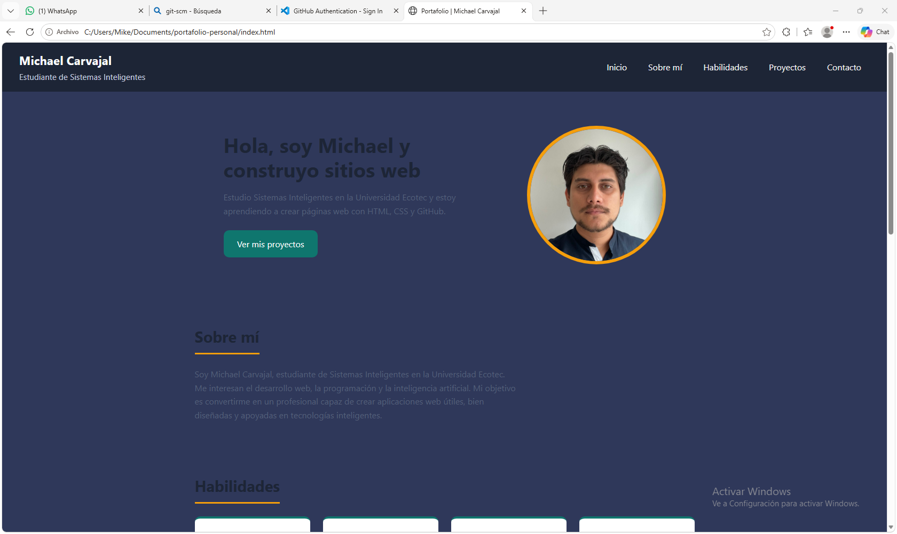

# Portafolio Personal

**Estudiante:** Michael Carvajal
**Carrera:** Sistemas Inteligentes, Universidad Ecotec
**Asignatura:** Programación de Sistemas Web
**Actividad:** Actividad Integradora 1

## Descripción

Sitio web que funciona como mi portafolio personal. Presenta mi información
básica, mis habilidades, mis proyectos y un formulario de contacto visual.
Tiene un diseño en tema oscuro y se adapta a pantallas de celular.

## Tecnologías utilizadas

- HTML5 con etiquetas semánticas (`header`, `nav`, `main`, `section`, `article`, `footer`)
- CSS3 (variables en `:root`, flexbox, pseudoclase `:hover`, media queries)
- Git y GitHub

## Cómo visualizar el proyecto

1. Clona o descarga este repositorio:
git clone https://github.com/micarvajal-gif/portafolio-personal.git
2. Abre la carpeta del proyecto.
3. Abre el archivo `index.html` en tu navegador.

## Captura de pantalla

